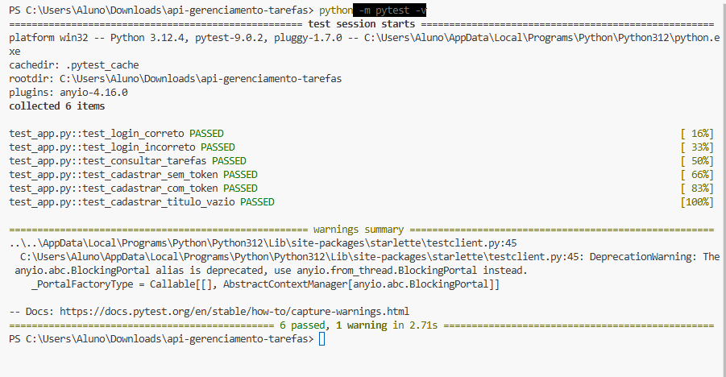

# API de gerenciamento de tarefas

Atividade avaliativa prática – 4º bimestre

## Integrantes

- Maria Luisa Mendonça

## Sobre o projeto

API REST para consultar e cadastrar tarefas. O login valida o hash da senha e gera um token JWT válido por uma hora. O cadastro exige autenticação e um título não vazio. As tarefas ficam em memória e são reiniciadas quando o servidor reinicia.

## Como executar

No terminal, dentro da pasta do projeto:

```bash
python -m venv .venv
```

Ative o ambiente virtual no Windows (PowerShell):

```powershell
.\.venv\Scripts\Activate.ps1
```

No Linux ou macOS: `source .venv/bin/activate`.

```bash
python -m pip install -r requirements.txt
python -m uvicorn app:app --reload
```

A API estará disponível em `http://127.0.0.1:8000`. A documentação interativa fica em `http://127.0.0.1:8000/docs`.

## Rotas

| Método | Rota | Função | Autenticação |
|---|---|---|---|
| POST | /login | Validar credenciais e retornar JWT | Não |
| GET | /tarefas | Listar tarefas | Não |
| POST | /tarefas | Cadastrar tarefa pendente | Sim |

## Testando no Bruno

Crie uma requisição POST para `http://127.0.0.1:8000/login` e selecione o corpo JSON:

```json
{"usuario": "admin", "senha": "123456"}
```

Copie o valor de `access_token` retornado. Para cadastrar, crie uma requisição POST para `http://127.0.0.1:8000/tarefas`, com o cabeçalho `Authorization: Bearer SEU_TOKEN` e corpo JSON:

```json
{"titulo": "Revisar os testes da API"}
```

Para listar, envie GET para `http://127.0.0.1:8000/tarefas` sem token.

## Testes automatizados

```bash
python -m pytest -v
```

Os seis testes verificam login válido (200), senha incorreta (401), consulta (200), cadastro sem token (401), cadastro válido (201) e título vazio, ausente ou composto por espaços (400). Na execução no Windows, os seis testes passaram em 2,71 segundos, com um aviso de depreciação de biblioteca.



As credenciais são apenas demonstrativas. A chave JWT é gerada ao iniciar o processo, ou pode ser configurada na variável de ambiente `JWT_SECRET`.
